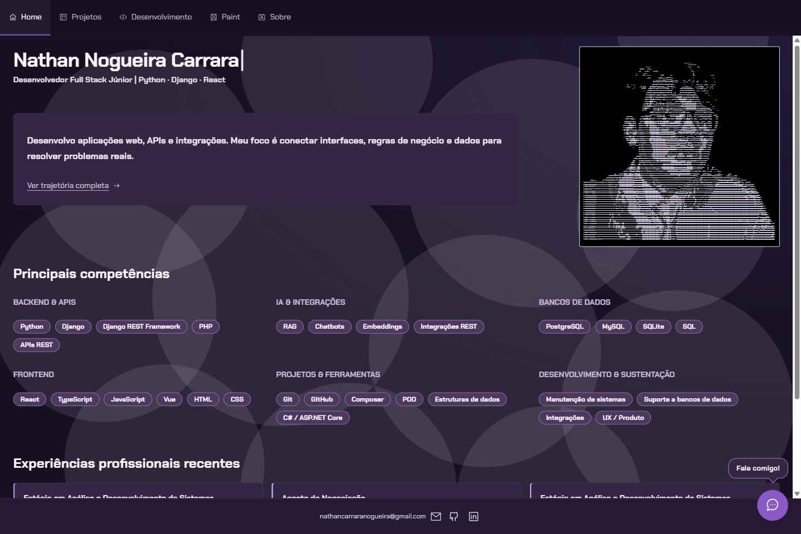

# Nathan Nogueira Carrara — Portfólio

[](https://github.com/Neitolas/portfolio-nathan/actions/workflows/ci.yml)

Portfólio pessoal de Nathan, com **11 projetos e estudos**, experiência, formação e contato. Apresentação próxima da referência, com paleta roxa, abas com ícones, fonte Chakra Petch, círculos translúcidos, cartões horizontais e rodapé fixo. Conteúdo próprio e retrato da foto fornecida, enquadrado na moldura branca. A página Desenvolvimento apresenta Backend, Frontend e IA.



## Executar no Windows

Use **Node.js 24 LTS** (validado com 24.20.0) e npm. Abra o terminal nesta pasta:

```powershell
npm.cmd ci
npm.cmd run dev
```

Abra a URL informada pelo Vite, normalmente `http://127.0.0.1:5173/`. Encerre o servidor com `Ctrl+C` antes de reinstalar dependências no Windows.

Para conferir o build de produção:

```powershell
npm.cmd run lint
npm.cmd test
npm.cmd run build
npm.cmd run preview
```

A prévia de produção usa **http://127.0.0.1:4173/**. Se a porta estiver ocupada, encerre a prévia anterior. O site completo está em `dist/` após o build; `vite preview` é um servidor de teste local.

Caso o wrapper `npm.cmd` fique pendente, use a CLI oficial instalada com o Node:

```powershell
$portfolioNpmCli = Join-Path (Split-Path (Get-Command node.exe).Source) 'node_modules\npm\bin\npm-cli.js'
node.exe $portfolioNpmCli ci
node.exe $portfolioNpmCli run dev
```

## Estrutura e edição

| Arquivo | Responsabilidade |
| --- | --- |
| `src/content.js` | Identidade, links, experiências, formação, competências e projetos |
| `src/render.js` | HTML semântico, escape de conteúdo e validação de protocolos |
| `src/portrait.js` | Retrato ASCII gerado a partir da foto fornecida pelo titular |
| `scripts/Gerar-Retrato.ps1` | Gerador local de caracteres com System.Drawing no Windows |
| `src/main.js` | Filtros acessíveis e diálogo de contato |
| `src/paint.js` | Desenho, moldes próprios, upload local, desfazer e exportação PNG |
| `src/style.css` | Identidade visual, layout responsivo e movimento reduzido |
| `vite.config.js` | Cinco entradas HTML estáticas e assets relativos |
| `index.html`, `projects/`, `development/`, `paint/`, `about/` | Entradas de Home, Projetos, Desenvolvimento, Paint e Sobre |
| `public/fonts/` | Chakra Petch Regular/Bold e licença SIL OFL 1.1 |
| `tests/render.test.js` | Testes nativos de renderização e segurança do HTML |
| `tests/browser-checks.js` | Função de QA para executar com uma página Playwright existente |
| `tests/paint-checks.js` | Regressões de toque, carregamento de imagens e janelas baixas |
| `.github/workflows/ci.yml` | Instalação, lint, testes e build em pushes/PRs |

Os textos são gerados no HTML pelo Vite. Navegação entre páginas, identidade, projetos e links do rodapé funcionam sem JavaScript. O Paint e o diálogo de contato usam JavaScript nativo; o contato abre e-mail, LinkedIn ou GitHub reais. Não há backend, conversa simulada ou dependências de runtime. As fontes são locais, sem chamadas ao Google durante o uso.

## Fontes e validação

- [Fontes do perfil e pendências](docs/fontes-perfil.md)
- [Catálogo de projetos e escopo verificado](docs/catalogo-projetos.md)
- [Origem e geração do retrato ASCII](docs/retrato-ascii.md)
- [Decisões visuais e técnicas](docs/decisoes.md)
- [Comandos e resultados de validação](docs/validacao.md)
- [Captura em celular](docs/evidencias/viewport-360.png) e [tablet](docs/evidencias/viewport-768.png)
- [Opções gratuitas de hospedagem](docs/hospedagem.md)

O LinkedIn não pôde ser lido nesta execução. O link do briefing foi preservado e sua divergência com o GitHub está registrada nas fontes. Datas e vínculos atuais devem ser confirmados antes de atualizar o conteúdo como atual. Nenhuma experiência, imagem ou infraestrutura da referência foi atribuída a Nathan.

O retrato ASCII foi criado com a foto fornecida diretamente pelo titular nesta conversa. Seus caracteres já estão no HTML, sobre preto e com contorno branco. A fotografia original não é necessária para executar o site; a origem não é apresentada como uma extração do LinkedIn. A fonte Chakra Petch foi obtida do [Google Fonts](https://github.com/google/fonts/tree/main/ofl/chakrapetch) e é distribuída com sua [licença](public/fonts/OFL.txt).

## Versionamento e publicação

Este projeto foi preparado para um **repositório público independente**: `Neitolas/portfolio-nathan`. A branch principal é `main`. O workflow de CI valida os próximos pushes e pull requests; o histórico Git registra cada versão.

Para publicar o site em um serviço estático, use:

| Configuração | Valor |
| --- | --- |
| Diretório raiz | Raiz deste repositório |
| Versão do Node | 24 |
| Instalação | `npm ci` |
| Build | `npm run build` |
| Diretório de saída | `dist` |
| Branch de produção sugerida | `main` |

O `base: './'` permite servir os arquivos na raiz ou em subpasta. Cada rota tem seu próprio `index.html` e não exige fallback de SPA: `/`, `/projects/`, `/development/`, `/paint/` e `/about/`. Após escolher o domínio, configurar canonical, `og:url` e imagem social absoluta com o endereço real. Não há deploy automático para um host; o workflow incluído executa verificações.
